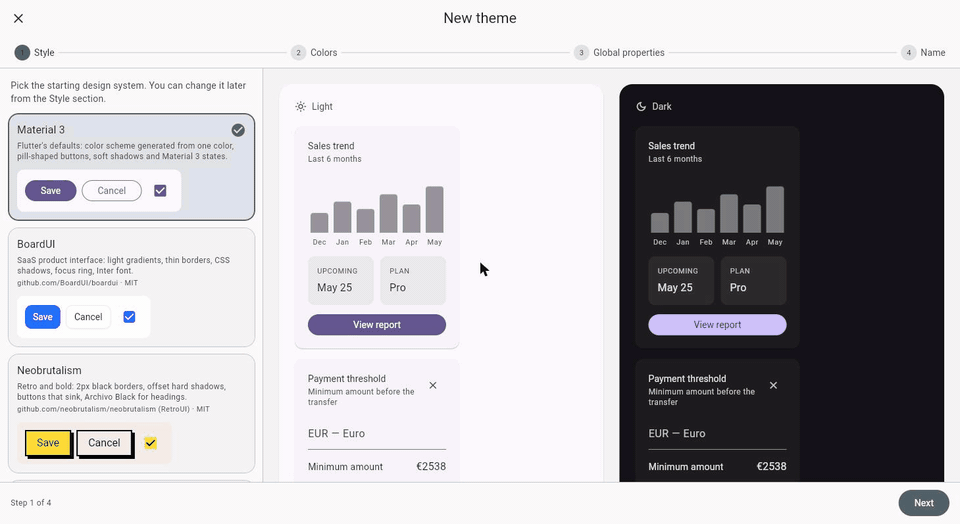
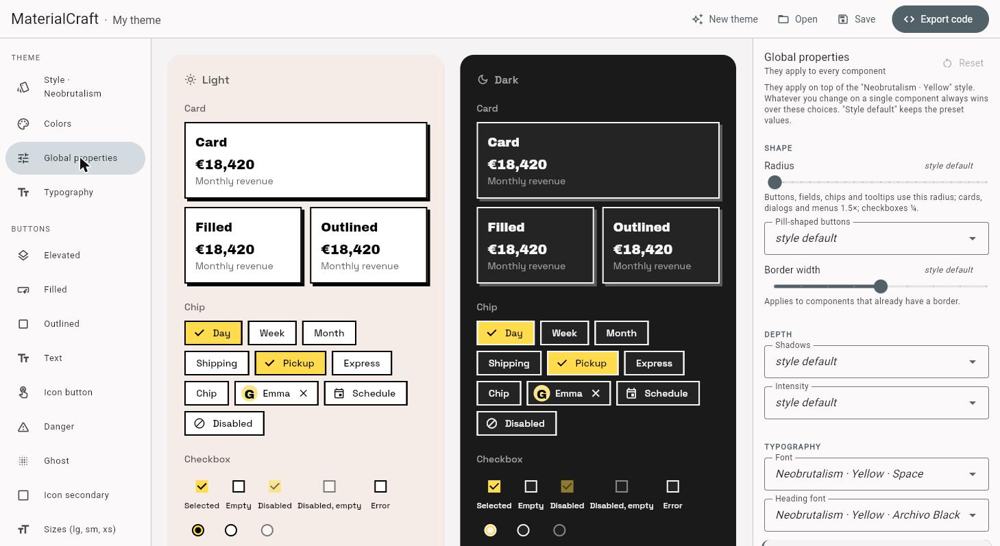
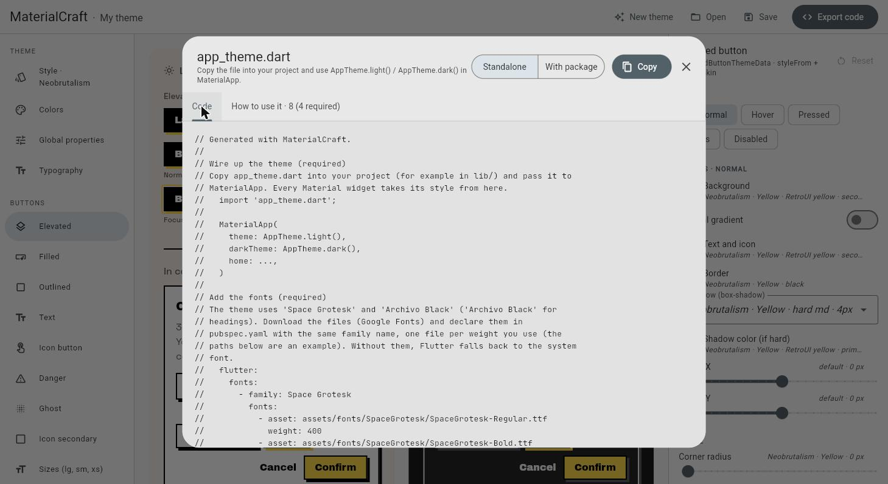
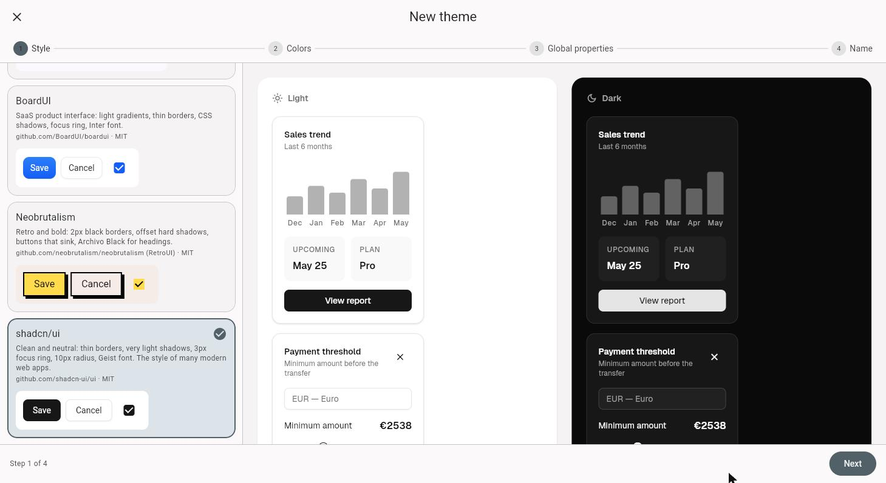
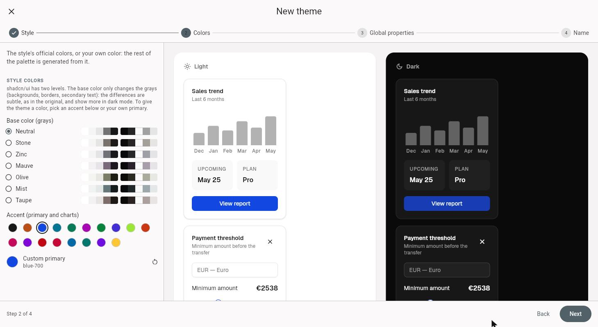

# MaterialCraft

**A visual theme editor for Flutter Material 3.** Pick a design system, tweak
every component with a live light/dark preview, and export a single
`app_theme.dart` you drop into your app.

**[Try it in your browser → materialcraft.danieleorlando.me](https://materialcraft.danieleorlando.me)**



MaterialCraft stays **on top of Material**: the export is a regular
`ThemeData` for `MaterialApp`, so `FilledButton`, `Card`, `TextField` and the
other Material widgets pick up the look by themselves. Where a theme can't
express something (a square switch thumb, extra button variants), the export
adds a small explicit helper and explains how to use it. It never replaces or
shadows a Material widget.

## Features



- **Four starting styles**, rebuilt from their sources:
  - **Material 3**: Flutter's defaults, with a seed color and optional key
    colors like the Material Theme Builder.
  - **shadcn/ui**: the classic new-york style plus the 8 styles of the new
    system (Vega, Nova, Maia, Lyra, Mira, Luma, Rhea, Sera), 7 base colors and
    17 accents.
  - **BoardUI**: SaaS look with light gradients, CSS shadows and a focus ring.
  - **Neobrutalism** (RetroUI): 2px borders, hard offset shadows and buttons
    that sink, in 7 palettes.
- **Your own colors**: choose a primary and the whole palette is generated
  with the rules of the chosen style.
- **Layered editing**: style → global properties (radius, borders, shadows,
  height, motion, fonts) → per-component edits. Change the style later and
  your edits stay on top.
- **About 30 components**: buttons in every state and size, text fields, cards,
  dialogs, bottom sheets, app bars, navigation bar and rail, list tiles, tabs,
  chips, badges, menus, tooltips, snack bars, checkboxes, radios, switches,
  sliders and typography.
- **Pixel-faithful states**: per-state colors, gradients, CSS-like shadows,
  focus rings and press motion, previewed side by side in light and dark.
- **Projects**: autosave in the browser, plus save and open
  `.materialcraft.json` files.
- **Share and gallery**: copy a link that opens your theme in the editor, or
  start from a theme in the [community gallery](gallery).

## Export



The export is one Dart file with `AppTheme.light()` and `AppTheme.dark()`:

```dart
import 'app_theme.dart';

MaterialApp(
  theme: AppTheme.light(),
  darkTheme: AppTheme.dark(),
  home: const HomePage(),
);
```

Two modes:

- **Standalone** (default): the file includes everything it needs, with no
  extra dependency.
- **With package**: the file imports
  [`materialcraft`](packages/materialcraft) from pub.dev, so it stays short
  and you get fixes with `flutter pub upgrade`.

And two Material libraries:

- **material_ui** (default): for Flutter 3.47+ apps migrated to the
  [`material_ui`](https://pub.dev/packages/material_ui) package
  (`dart fix --apply --code=migrate_design_widgets`); uses `materialcraft`
  ^0.2.0.
- **flutter/material**: for Flutter before 3.47, or apps that still import
  `package:flutter/material.dart`; uses `materialcraft` ^0.1.0.

The exported code is formatted with `dart format` and passes
[`very_good_analysis`](https://pub.dev/packages/very_good_analysis).
`AppTheme.light()` / `dark()` also take an optional `ColorScheme`, for the
Android 12+ dynamic colors of
[`dynamic_color`](https://pub.dev/packages/dynamic_color).

The **How to use it** tab lists only the steps your theme actually needs, such
as adding fonts or using `AppSwitch`, with before/after code.

## New theme wizard

| Style | Colors |
| --- | --- |
|  |  |

## Gallery

The [gallery](https://materialcraft.danieleorlando.me/gallery) shows themes
made with MaterialCraft, one `.materialcraft.json` file per theme in
[`gallery/`](gallery). To add yours, click **Submit** in the editor's toolbar
(or **Share → Submit to gallery**): it opens a prefilled GitHub issue. A bot checks the theme and opens a pull
request, and the theme shows up with your GitHub name once it's merged.

## Run it locally

Requires Flutter 3.47 or later.

```sh
flutter pub get
flutter run -d chrome
```

Tests:

```sh
flutter test
(cd packages/materialcraft && flutter test)
```

## Project layout

| Path | What's there |
| --- | --- |
| `lib/editor/` | The editor UI: sidebar, property panels, preview, wizard, export dialog. |
| `lib/model/` | Theme configuration, presets, color math and the `ThemeData` builder used by the preview. |
| `lib/export/` | The Dart exporter and the usage notes. It mirrors `lib/model/theme_builder.dart`, so the preview shows exactly what the exported code produces. |
| `packages/materialcraft/` | The runtime package (`ButtonSkin`, `AppButtonStyles`, `AppSwitch`, `HardShadowBorder`, slider shapes). |
| `tool/` | Generators that turn the design systems' CSS into Dart tokens, with the copied sources and their licenses. |

After changing the package sources, run `tool/gen_skin_source.sh` so that
standalone exports include the same code. A test fails if you forget.

The package keeps two lines: `main` holds 0.2.x (`material_ui`), the
`release/0.1.x` branch holds 0.1.x (`flutter/material`, Flutter 3.35+) for
bug fixes. Fix on `main`, cherry-pick onto `release/0.1.x` keeping the
`flutter/material` import, bump to 0.1.(n+1), test with Flutter 3.35 and
publish from that branch. The tag of each release is
`materialcraft-v<version>`.

## Credits

The presets are based on these open source projects (MIT). Their sources and
licenses are in `tool/`:

- [shadcn/ui](https://github.com/shadcn-ui/ui)
- [BoardUI](https://github.com/BoardUI/boardui)
- [RetroUI / neobrutalism](https://github.com/neobrutalism/neobrutalism)
- [Tailwind CSS](https://github.com/tailwindlabs/tailwindcss) color palette

MaterialCraft is not affiliated with these projects.

## Author

Built by **Daniele Orlando**, a developer who builds iOS, Android and web apps
from the first idea to the store.

Need an app, an MVP or a design system?
[danieleorlando.me](https://danieleorlando.me) ·
[LinkedIn](https://www.linkedin.com/in/daniele-orlando-2b491014/) ·
[GitHub](https://github.com/danieleorlando)

## License

[MIT](LICENSE)
