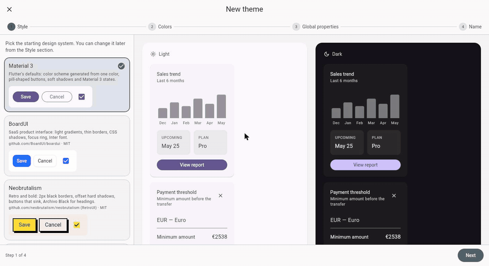
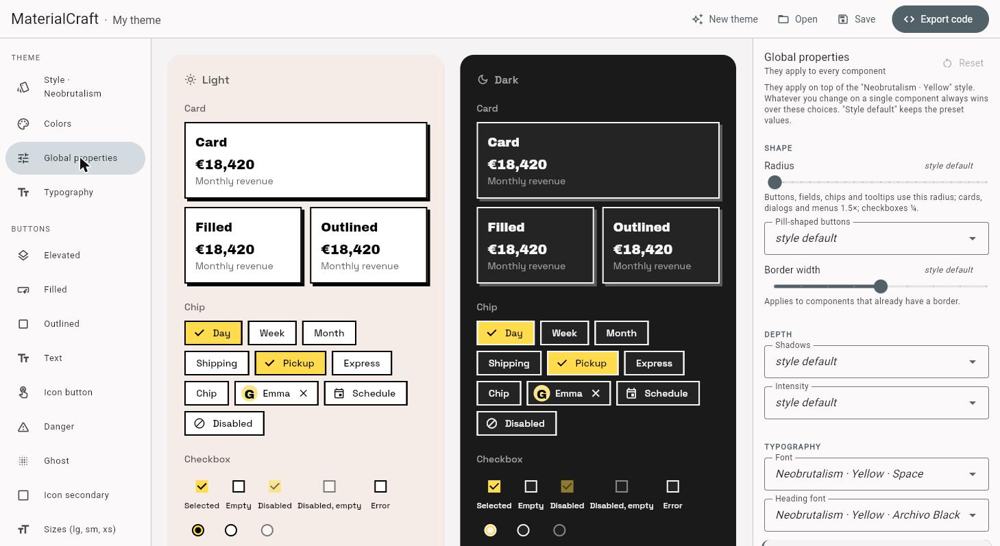
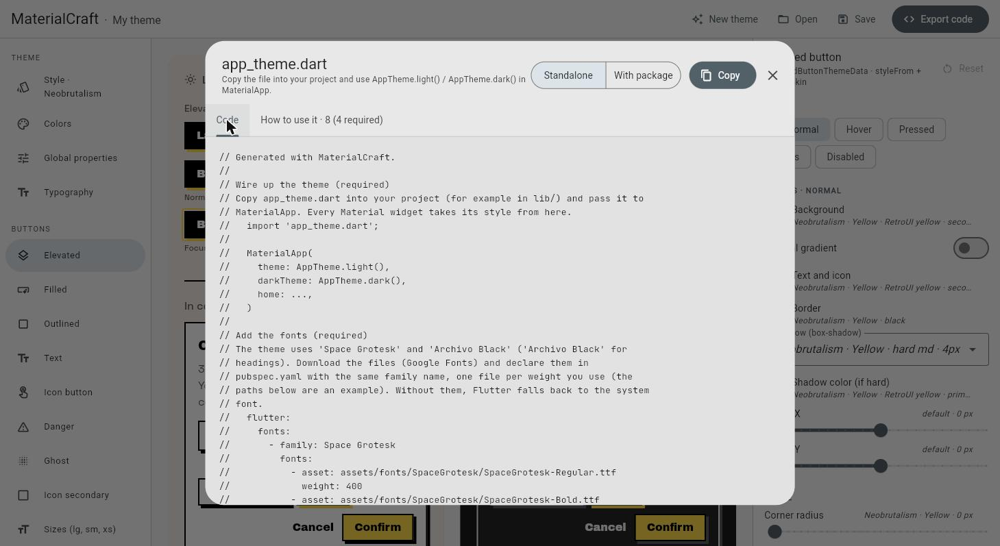

<p align="center">
  <a href="https://materialcraft.danieleorlando.me">
    
  </a>
</p>

<h1 align="center">materialcraft</h1>

<p align="center">
  <b>Runtime widgets for themes made with MaterialCraft,<br>
  the visual theme editor for Flutter Material 3.</b>
</p>

<p align="center">
  <a href="https://pub.dev/packages/materialcraft"></a>
  <a href="https://github.com/danieleorlando/materialcraft/blob/main/LICENSE"></a>
  <a href="https://materialcraft.danieleorlando.me"></a>
</p>

<p align="center">
  <a href="https://materialcraft.danieleorlando.me"><b>Open the editor →</b></a> ·
  <a href="https://github.com/danieleorlando/materialcraft">GitHub</a>
</p>

---

**Design your theme in the browser, export one `app_theme.dart`, and use
it with `MaterialApp`.** Your `FilledButton`, `Card`, `TextField` and the
rest of the Material widgets pick up the new look by themselves.

This package holds the runtime part of that export: gradients, CSS-like
shadows, hard offset borders, square switches and the rest of the details
that `ThemeData` can't express on its own. All of it is built **on top of
Material**, as theme extensions, borders and shapes that plug into the
standard themes. Nothing replaces or shadows a Material widget.

## ✨ Four starting styles

| Material 3 | shadcn/ui | BoardUI | Neobrutalism |
| --- | --- | --- | --- |
| Flutter's defaults with a seed color and optional key colors. | new-york plus 8 new styles, 7 base colors, 17 accents. | SaaS look with light gradients, soft shadows and a focus ring. | 2px borders, hard offset shadows and buttons that sink. |

Choose a primary color and the editor builds the whole palette with the rules
of that style. Then change the radius, borders, shadows, fonts and motion, and
fine-tune about 30 components, with light and dark previewed side by side.



## 🚀 Quick start

1. Design your theme at
   **[materialcraft.danieleorlando.me](https://materialcraft.danieleorlando.me)**.
2. Export it in **With package** mode and add `app_theme.dart` to your project.
3. Add the dependency:

```yaml
dependencies:
  materialcraft: ^0.1.1
```

4. Use the theme:

```dart
import 'app_theme.dart'; // exported by MaterialCraft

MaterialApp(
  theme: AppTheme.light(),
  darkTheme: AppTheme.dark(),
  home: const HomePage(),
);
```

That's all. The **How to use it** tab in the export dialog lists any extra
step your theme needs, such as fonts or `AppSwitch`, with before/after code.

> **Why use the package?** The exported file stays short, and you get
> fixes with `flutter pub upgrade` without exporting the theme again. If you
> want no dependencies at all, pick **Standalone** mode, which bundles this
> same code into `app_theme.dart`.



## 🧩 What's inside

| API | What it does |
| --- | --- |
| `ButtonSkin` / `ButtonSkinState` | Per-state gradients, CSS-like inner and outer shadows, focus ring and press effect for Material buttons. |
| `AppButtonStyles` + `context.buttonStyle(...)` | Extra button variants (danger, ghost, …) and sizes (large, small, xs) as a `ThemeExtension`. |
| `HardShadowBorder` / `HardShadowInputBorder` | Borders with a hard, offset shadow (neobrutalism) for cards, dialogs, menus and text fields. |
| `AppSwitch` / `AppSwitchStyle` | A switch with the theme's geometry (square thumb, borders). Without an `AppSwitchStyle` it renders the regular Material `Switch`. |
| `SoftSliderThumbShape`, `GradientSliderTrackShape` (+ range variants) | Slider thumb with border and shadow, gradient track. |

### Extra button variants and sizes

```dart
FilledButton(
  style: context.buttonStyle(AppButtonKind.danger),
  onPressed: () {},
  child: const Text('Delete'),
);

OutlinedButton(
  style: context.buttonStyle(AppButtonKind.outlined, size: AppButtonSize.small),
  onPressed: () {},
  child: const Text('Small'),
);
```

### A switch that follows the theme

```dart
AppSwitch(value: on, onChanged: (v) => setState(() => on = v));
```

## 🙏 Credits

The presets are based on these open source projects (MIT):
[shadcn/ui](https://github.com/shadcn-ui/ui),
[BoardUI](https://github.com/BoardUI/boardui),
[RetroUI / neobrutalism](https://github.com/neobrutalism/neobrutalism) and the
[Tailwind CSS](https://github.com/tailwindlabs/tailwindcss) color palette.
MaterialCraft is not affiliated with these projects.

## 👋 Author

Built by **Daniele Orlando**, a developer who builds iOS, Android and web apps
from the first idea to the store.

Need an app, an MVP or a design system?
[danieleorlando.me](https://danieleorlando.me) ·
[LinkedIn](https://www.linkedin.com/in/daniele-orlando-2b491014/) ·
[GitHub](https://github.com/danieleorlando)
